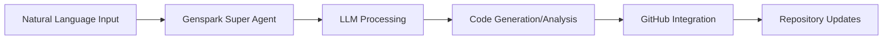

# FitLife – 운동·식단·수면 통합 건강관리 웹앱

## 개요
모바일 우선 SPA. 로그인 후 하단 탭 4개(홈 / 헬스 / 수면 / 내정보)로 건강 데이터를 기록하고 분석합니다.

## 완료된 기능
- **초기화면**: 로그인(아이디/비밀번호), 회원가입, 아이디 찾기(이름+이메일, 마스킹 표시), 비밀번호 찾기(아이디+이메일 → 임시 비밀번호 발급)
- **홈**: 월간 캘린더(일정/운동/수면/식단 기록 도트 표시, 날짜 선택), 선택일 일정(추가·완료·삭제), 수면시간, 운동기록(MET 기반 칼로리 자동계산), 식단 칼로리(끼니별), 구간별 통계 그래프(1주/1개월/3개월/1년 × 운동량·운동시간·신체정보)
- **📸 AI 사진 칼로리 측정**: 음식 사진 촬영/업로드 → GPT 비전 모델(gpt-5-mini)이 음식별 양·칼로리·탄단지 추정 → 항목 선택/칼로리 수정 → 날짜·끼니 지정 후 식단에 기록 (썸네일 + AI 뱃지 저장). 헬스>식단 탭 및 홈 식단 카드에서 사용
- **헬스**: AI 운동가이드(인바디·최근 운동량·수면 분석 리포트 + 목표/레벨별 주간 루틴 + 권장 영양), 식단(끼니별 기록, 빠른 음식 선택, 탄단지 차트), 장기 목표(D-day, 진행률), 월별 목표(월 실적 자동 집계)
- **수면**: 원터치 취침/기상 타이머, 수면시간 체크(자정 넘김 자동 계산), 수면상태 체크(만족도 별점, 상태 태그, 메모), 2주 그래프·평균
- **내정보**: 개인정보 수정, 비밀번호 변경, 인바디 갱신(BMI/체지방률 자동 계산) 및 이력

## API (모두 JSON, `/api/auth/*` 외에는 세션 쿠키 필요)
| 경로 | 설명 |
|---|---|
| POST `/api/auth/signup` `login` `logout` `find-id` `reset-password` | 인증 |
| GET/PUT `/api/me`, PUT `/api/me/password` | 내 정보 |
| GET/POST/PUT/DELETE `/api/{schedules,sleep,workouts,meals,inbody,goals}` | CRUD (`?from=&to=`, goals: `?kind=&month=`) |
| POST `/api/meals/analyze` `{image: dataURL, hint?}` | AI 음식 사진 칼로리 분석 |
| GET `/api/summary?date=YYYY-MM-DD` | 홈 일별 요약 + 월 캘린더 마크 |
| GET `/api/stats?days=7` | 기간 통계 |
| GET `/api/ai-guide?goal=diet|muscle|health&level=beginner|intermediate|advanced` | AI 운동 가이드 |

## 데이터 구조 (Cloudflare D1)
users, sessions, schedules, sleep_logs, workouts, meals, inbody, goals — `migrations/0001_init.sql`
비밀번호는 PBKDF2-SHA256(10만회)+salt 해시, 세션은 HttpOnly 쿠키(30일).

## 환경 변수 (시크릿)
- `OPENAI_API_KEY`, `OPENAI_BASE_URL` — 로컬은 `.dev.vars`(git 제외), 프로덕션은 `wrangler pages secret put`

## 미구현 / 다음 단계
- AI 가이드는 현재 규칙 기반 개인화 → OpenAI 등 LLM API 연동 가능
- 이메일 인증 기반 비밀번호 재설정(현재는 화면에 임시 비밀번호 표시)
- 웨어러블/건강앱 연동, 푸시 알림, 음식 DB 검색
- 프로덕션 배포(Cloudflare D1 생성 후 `database_id` 교체)

## 로컬 실행
```
npm run build && npm run db:migrate:local && pm2 start ecosystem.config.cjs
```
- **Tech**: Hono + Cloudflare Pages/D1 + Tailwind(CDN) + Chart.js
- **상태**: 샌드박스 개발 서버 동작 중 / 프로덕션 미배포
- **Last Updated**: 2026-10-06

---
## About this repository (original content)

